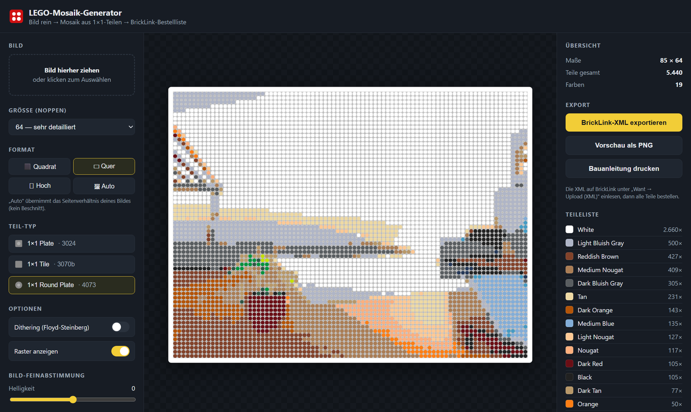

# Brick Mosaic Generator

Turn any photo into a mosaic made of 1×1 bricks – with a **ready-to-order BrickLink Wanted List** and a **printable color-by-number building guide**.

One HTML file, no install, no server, nothing is uploaded: your image never leaves the browser.

**▶ Try it:** open `index.html` in any modern browser, or use the live version on GitHub Pages: **https://gamingpaule.github.io/brick-mosaic-generator/**

## Features

- **Three part types:** 1×1 Plate (3024), 1×1 Tile (3070b), 1×1 Round Plate (4073)
- **Sizes** 16 / 32 / 48 / 64 studs (matching common baseplates) or any custom size
- **Formats:** square, landscape, portrait or auto (keeps the image's aspect ratio)
- **Accurate color matching** with **CIEDE2000**, the perceptual color-difference formula
- **Gamma-correct downscaling:** pixels are averaged in linear light, so fine detail doesn't turn muddy
- Optional **Floyd–Steinberg dithering** (serpentine scan)
- Brightness, contrast and saturation sliders
- Optional **frame** in any thickness and color
- **Exports:**
  - BrickLink Wanted List **XML**: upload it under *Want → Upload* and order every part in one go
  - Preview **PNG**
  - Printable **building guide** (color-by-number grid + parts legend)

## Why a curated palette?

The palette has 39 solid colors that are **widely available as 1×1 parts on BrickLink**, not every color that has ever existed. A mosaic is only useful if you can actually buy the parts, so orderability beats the last bit of color accuracy. Each color uses the exact BrickLink swatch RGB and the confirmed BrickLink color ID, and only offers the part types it really exists in (some colors come as plate and tile but not as a round plate).

Availability is a curated estimate, not a live check. Glance over the Wanted List on BrickLink before you order.

## How it works

1. The image is cropped to the selected format and scaled down to one pixel per stud (gamma-correct averaging).
2. Brightness, contrast and saturation adjustments are applied.
3. Every pixel is converted to CIELAB and matched to the closest palette color with CIEDE2000 (optionally with error diffusion).
4. The part counts per color become the BrickLink XML (`ITEMTYPE P`, part number, color ID, quantity).

## Language

The interface is in **German**. A translation PR is welcome.

## Disclaimer

LEGO® is a trademark of the LEGO Group, which does not sponsor, authorize or endorse this project. BrickLink® is a trademark of the LEGO Group as well.

## License

[MIT](LICENSE) © 2026 Paul Hohmann

---

### 🇩🇪 Kurz auf Deutsch

Bild reinziehen, Größe und Teil-Typ wählen und die BrickLink-XML exportieren. Mit der Datei lassen sich alle Teile direkt bestellen. Die Bauanleitung druckst du als Color-by-Number-Raster. Alles läuft offline im Browser in einer einzigen HTML-Datei.
